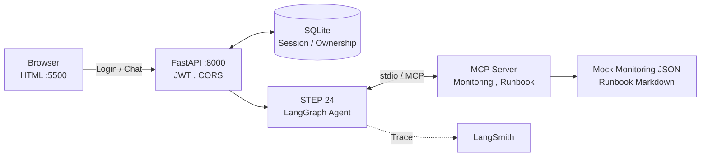
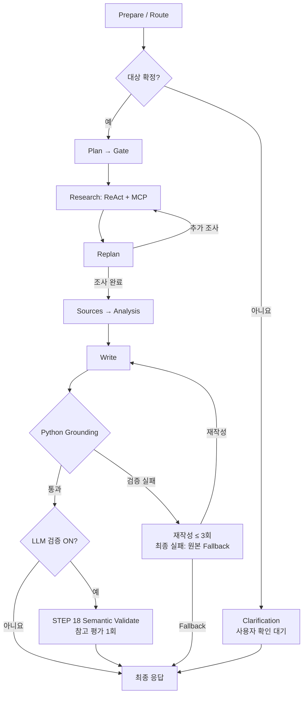
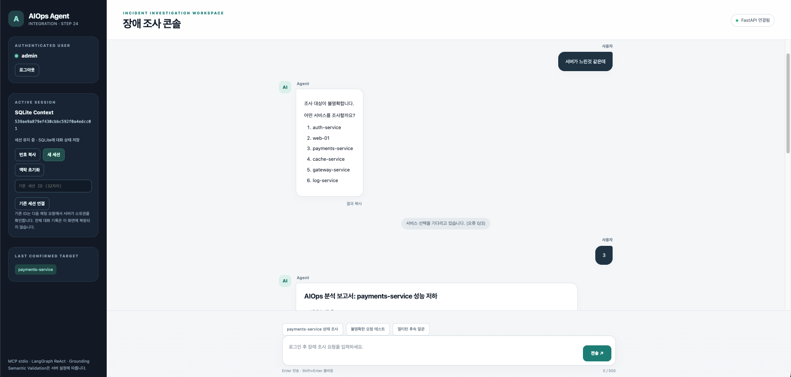

# AIOps Agent — 베이스 코드를 해체하고 24단계로 다시 만들기

**SKALA 4기 광주캠퍼스 2반 우상민**  
고유번호: `G055`

> **핵심:** 제공된 AIOps Agent 예제를 수정하는 데서 그치지 않고, **개발 환경부터 각 구성 요소를 단계별로 재구현**했습니다. 이후 직접 발견한 문제를 개선하며 **어디에 LLM Agent가 필요하고, 어디는 결정적 코드로 통제해야 하는지** 탐색했습니다.
>
> **발표:** 이 README는 5분 발표용 요약입니다. 코드별 학습 과정과 시행착오는 [상세 PDF 보고서](./w15_miniAIp.pdf)에 기록했습니다.

---

## 1. How to Run

**환경:** macOS / Python 3.11 / [uv](https://docs.astral.sh/uv/) / [Ollama](https://ollama.com/)  
**모델:** `qwen3.5:9b` **실행:** FastAPI + 브라우저 HTML **저장소:** SQLite

<details>
<summary><b>최초 1회 — 환경 설정 및 계정 생성 (클릭해서 펼치기)</b></summary>

```bash
# 저장소 루트에서 실행
uv venv --python 3.11
source .venv/bin/activate
uv pip install -r requirements.txt

# 실제 키와 비밀키를 .env에 설정
cp .env.example .env
python -c "import secrets; print(secrets.token_urlsafe(32))"
# 생성된 값을 .env의 AIOPS_JWT_SECRET에 입력
# LANGSMITH_API_KEY에는 실제 키 입력 (사용하지 않으면 LANGSMITH_TRACING=false)

# Ollama 앱 또는 ollama serve가 실행 중이어야 합니다.
ollama pull qwen3.5:9b
python step23_auth_api.py --create-user admin
# 비밀번호 입력 (8자 이상)
```

`requirements.txt`는 프로젝트 전용 가상환경에서 `uv pip freeze > requirements.txt`로 생성한 환경 기록입니다.

</details>

**시연 실행 — 터미널 3개**

```bash
# Terminal 1 — Ollama (이미 실행 중이면 생략)
ollama serve
```

```bash
# Terminal 2 — 인증 API + 최종 Agent
source .venv/bin/activate
ENABLE_SEMANTIC_VALIDATION=true uvicorn step23_auth_api:app --reload --port 8000
```

```bash
# Terminal 3 — HTML 제공 서버
python -m http.server 5500
```

**접속:** http://127.0.0.1:5500/step24_integration_ui.html  
**순서:** 로그인 → 세션 생성 → 장애 요청 → 재질문, 후속 질문 → Grounding 보고서 확인

<details>
<summary><b>개발, 검증용 명령어 및 연결 설정 (클릭해서 펼치기)</b></summary>

최종 API가 STEP 24를 사용하도록 `step21_sqlite_session.py`의 import를 다음과 같이 연결해야 합니다.

```python
from step24_integration import graph
from step20_clarification_hybrid import mentioned_services, unknown_services
```

```bash
# 최종 LangGraph 구조 출력 및 단독 실행
ENABLE_SEMANTIC_VALIDATION=true python step24_integration.py

# Grounding / 인증 독립 테스트
python step22_test.py
python step23_test.py
```

- `ENABLE_SEMANTIC_VALIDATION=false`: Python Grounding만 적용
- `ENABLE_SEMANTIC_VALIDATION=true`: Grounding 통과 시 LLM 의미 검증도 1회 수행
- LangSmith: `.env`의 `LANGSMITH_TRACING`, `LANGSMITH_PROJECT`, `LANGSMITH_API_KEY` 설정
- 브라우저 포트 `5500`과 API 포트 `8000`은 FastAPI `CORSMiddleware`로 연결

</details>

---

## 2. Project Overview — 무엇을, 왜 다시 만들었나?

### 프로젝트 목표

교수님이 제공한 **`all_total_vue_student.zip` AIOps Agent 베이스 코드**를 해체분석한 뒤, **빈 개발 환경에서 STEP 01~24로 기능을 순차 재구현**했습니다. 처음에는 기존 동작을 이해하고 재현하고, 이후에는 서비스 대상 검증, 대화 상태 관리, 근거 검증 등 발견한 문제를 직접 보완했습니다.

이 프로젝트의 목적은 완성형 상용 서비스를 개발하는 것이 아니라, **Agent 아키텍처의 각 요소가 왜 필요한지 확인하고 설계 선택의 효과와 한계를 실험하는 것**입니다.

### 원본 대비 재구현 / 개선 사항

| 영역 | 제공된 베이스 코드 | 이번 프로젝트에서 한 일 |
|:--|:--|:--|
| **개발 방식** | 완성된 Supervisor 기반 예제 제공 | Python 입출력부터 LangGraph,MCP,API까지 **24단계로 직접 재구현** |
| **조사 수행** | Task 기반 Research, 재계획, 검증 흐름 존재 | Plan과 **ReAct Tool 선택**을 분리해 구현하고, Replan,Gate 동작을 각각 실험 |
| **조사 대상** | 불명확한 대상에 기본 서비스가 선택될 수 있음 | 등록 서비스 검증 + **Clarification / LLM Fallback 1회**로 확인 전 조회 보류 |
| **멀티턴** | 대화 이력은 있으나 조사 대상, 증상의 Plan 전달이 제한적 | **SQLite에 조사 맥락과 확인 대기 상태 저장**, 재접속 복원 및 `/context` 검증 |
| **보고서 신뢰성** | LLM 기반 Validate | MCP 원본의 **출처 ID,필드,값을 Python Grounding으로 대조**, LLM 의미 검증은 선택 적용 |
| **API 접근 제어** | 학습용 API 중심 | FastAPI **OAuth2 Password + JWT**, 사용자별 세션 소유권 검사 |

**Agent의 역할:** CPU,Memory 조회나 임계값 판단은 Python으로도 가능합니다. LLM은 **어떤 서비스와 도구를 어떤 순서로 조사할지**, 관측 결과에 따라 추가 확인이 필요한지를 판단하는 부분에서 활용 가능성을 탐색했습니다.

---

## 3. Step-by-Step Development

**STEP 01~19: 베이스 아키텍처를 이해하기 위한 재구현**  **STEP 20~24: 발견한 문제 개선 및 통합**

| STEP | 구현 내용 | 핵심 학습, 검증 포인트 |
|:--:|:--|:--|
| 01–02 | Monitoring → Diagnosis | Mock JSON 조회와 판단 로직 분리 |
| 03–05 | LangGraph → Rule/LLM Routing | State, Conditional Edge, LLM 의도 분류 |
| 06–07 | Planning → Research | Task 생성, 상태 관리, `collected` 결과 분리 |
| 08 | FastAPI / CORS | 서로 다른 Origin의 브라우저 요청 허용 |
| 09–10 | MCP stdio → Research 연동 | Client가 Server 프로세스를 실행하고 Tool 호출 |
| 11–13 | Write / MCP Resource / MCP Prompt | 보고서 생성, Runbook 조회, 프롬프트 재사용 |
| 14–15 | Gate / Analysis | 코드 기반 작업 통제, 분석과 보고서 작성 책임 분리 |
| 16 | ReAct | 결과 관찰 후 LLM이 다음 Tool을 선택 |
| 17 | FastAPI 통합 | 입력 검증, 예외 처리, HTML 연결 |
| 18 | Replan / LLM Validate | 추가 조사, 보고서 재작성과 반복 제한 |
| 19 | LangSmith | Node/Tool/LLM 실행 경로 및 지연시간 추적 |
| **20** | **Hybrid Clarification** | **등록 서비스 검사 → 불명확하면 LLM 질문 → 사용자 확인** |
| **21** | **SQLite Multiturn** | **맥락 저장, 복원, 세션 유효성 검증, `/context`** |
| **22** | **Deterministic Grounding** | **출처, 필드, 수치, Runbook 원문 대조, 재작성/Fallback** |
| **23** | **OAuth2 + JWT** | **FastAPI 인증, 사용자별 세션 접근 제어** |
| **24** | **Final Integration** | **기존 그래프 재사용 + 선택적 LLM 의미 검증** |

> 각 단계의 코드, 실행 화면, 시행착오는 [상세 PDF 보고서](./assets/miniAIp_detail_report.pdf) 참조.

---

## 4. Final Integration — 어떤 코드를 재사용했나?

최종 단계는 이전 기능을 새로 작성하지 않고, **기존 파일을 import해 조합**하는 방식으로 구성했습니다.

```text
step24_integration_ui.html          브라우저 시연 UI
    │ /token ,  /session ,  /chat
    ▼
step23_auth_api.py                 OAuth2/JWT ,  CORS ,  API 입력 검증
    │ run_chat()
    ▼
step21_sqlite_session.py          SQLite 세션 저장, 복원 ,  후속 질문 맥락
    │ graph.ainvoke()
    ▼
step24_integration.py             최종 Graph: 기존 STEP 22 + 선택적 STEP 18
    ├── step22_grounding.py        출처 생성 ,  Python Grounding ,  Fallback
    │     └── step20_clarification_hybrid.py
    │           └── step18_replan_validate.py
    │                 └── step16_react.py → MCP stdio
    └── step18_replan_validate.py  LLM Validate 함수 재사용
```

**핵심 재사용 코드**

```python
from step22_grounding import graph as grounding_graph
from step18_replan_validate import validate_node as llm_validate_node

builder.add_node("grounding_agent", grounding_graph)  # 기존 그래프를 서브그래프로 활용
```

`ENABLE_SEMANTIC_VALIDATION`이 활성화되고 Python Grounding이 통과하면 STEP 18의 LLM Validator를 **추가로 1회 호출**합니다. 실패 시 Grounding 보고서는 보존하고 의미 검증 결과를 표시합니다.

---

## 5. Architecture

### 전체 시스템



### 최종 LangGraph 실행 흐름 (요약)



실제 노드 계층은 `step24_integration.py`의 `graph.get_graph(xray=True).draw_mermaid()`로 확인할 수 있습니다.

---

## 6. Key Insights — 구현하며 얻은 것

**01 | 정형 데이터에 LLM이 반드시 필요한 것은 아니다.**  
상태 조회, 임계값 검사, 수치 비교는 결정적 코드에 적합합니다. Agent의 활용 가능성은 **상황에 따라 조사 대상, Tool, 순서, 추가 조사 여부를 결정하는 과정**에서 탐색했습니다. 비기술직 운영담당자뿐 아니라 주니어 운영자, SRE/DevOps의 초기 조사 부담을 줄이는 용도도 생각해 볼 수 있습니다.

**02 | Plan, ReAct, Replan은 서로 다른 결정이다.**  
**Plan**은 전체 조사 작업을 설계하고, **ReAct**는 관측 결과를 바탕으로 다음 Tool을 선택하며, **Replan**은 조사 완료 후 부족한 작업을 새로 추가할지 결정합니다. 서로 대체하는 개념이 아닙니다.

**03 | Clarification은 질문을 잘 만드는 것만으로 완성되지 않는다.**  
등록 목록을 Python으로 확인하고 LLM은 불명확할 때만 **1회 Fallback**으로 질문을 생성하도록 했습니다. 한편 실제 장애 요청이 `chat`으로 잘못 라우팅되면 **재질문 단계에 아예 진입하지 못한다**는 위험을 확인했습니다. 향후 `unclear` 분기가 개선 후보입니다.

**04 | 저장된 맥락과 이해된 맥락은 다르다.**  
SQLite로 이전 조사 대상인 payments-service를 복원하는 데 성공했지만, 후속 요청인 '그 서비스 메모리도 확인해줘'에서는 기존 CPU 분석에 치중한 보고서가 생성되었습니다. 이를 통해 이전 상태의 저장, 복원과 새로운 사용자 의도의 해석은 별개 문제임을 확인했습니다. 저장, 복원의 정확성은 `/context` 명령어와 세션 ID 검증으로 확인했습니다.

내용을 sLLM의 한계로 두지않고 **Context Interpretation의 필요성을 확인했습니다.**

**05 | 사실 검증과 의미 검증은 분리할 수 있다.**  
STEP 22의 **Python Grounding**은 MCP 원본의 `source_id + field + value` 및 Runbook 인용을 대조합니다. STEP 18의 **LLM Validation**은 근거 없는 단정 등을 평가합니다. 최종 통합에서는 Grounding을 기본으로, LLM 의미 검증은 선택적으로 결합했습니다.

**06 | 관측 가능성은 디버깅의 출발점이다.**  
LangSmith Waterfall을 통해 Tool 호출보다 **로컬 LLM의 Write 단계**에 시간이 집중되는 실행 사례를 확인했습니다. Node 단위 Trace는 정확도뿐 아니라 지연시간 병목을 분석하는 근거가 됩니다.

---

## 7. Limitations & Next Steps

- **자연어 맥락 해석:** Routing 오분류와 일부 문장형 선택, 후속 질문 해석은 추가 개선 여지가 있습니다.
- **Grounding 범위:** 구조화된 모니터링 필드와 Runbook 원문 일치를 확인합니다. **원천 데이터의 진실성이나 장애 원인의 인과관계**까지 보장하지는 않습니다.
- **실습 범위:** Mock 모니터링 데이터, 로컬 Ollama, stdio MCP를 사용합니다. RAG(Vector DB), Human-in-the-loop 승인, 운영 환경 수준의 보안, 동시성 고도화는 구현 범위에서 제외했습니다.

---

## 8. Final Demonstration

**추천 시연 흐름:** 로그인 → `서버가 느린 것 같아` → 서비스 선택 → MCP 조사, 보고서 확인 → `그 서비스 메모리도 확인해줘` → LangSmith Waterfall 확인



> LangSmith는 별도 이미지 대신 발표 중 실행 화면으로 시연합니다.

---

## 9. Detailed Report

**[상세 프로젝트 보고서 (PDF)](./assets/miniAIp_detail_report.pdf)**  
STEP별 구현 코드와 실행 결과, 문제 발견, 수정 과정, 실험 중 얻은 인사이트를 기록했습니다.
